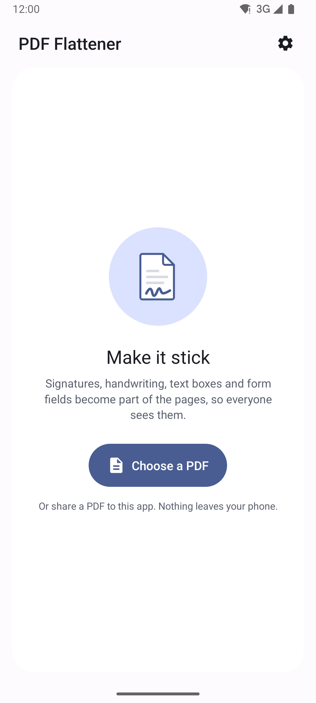
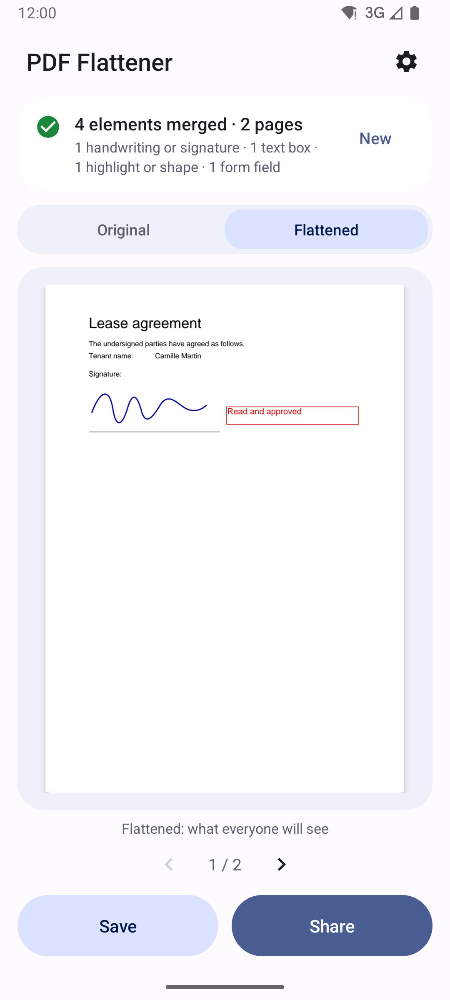
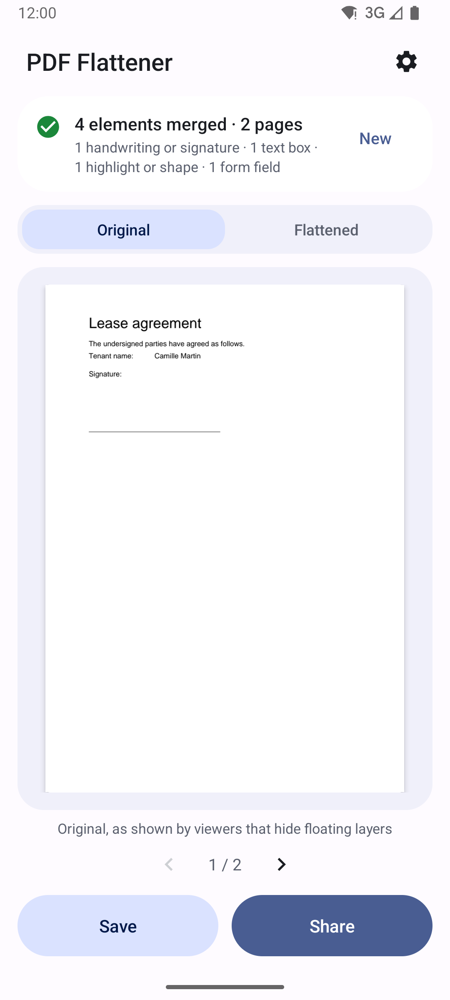
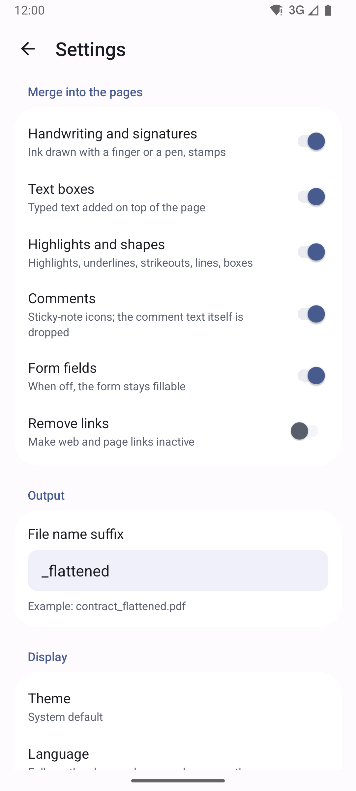
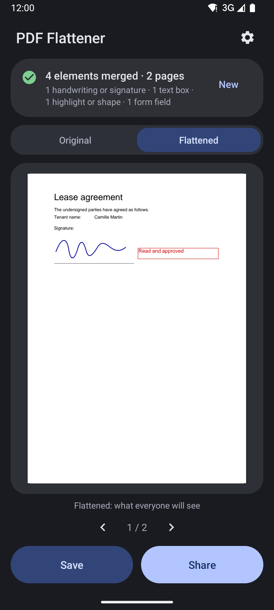

# PDF Flattener

A minimalist, 100% offline Android app that **flattens** PDFs: handwritten signatures, annotations, notes, stamps and form fields are permanently merged into the page content. The result looks the same in every reader, browser and mobile preview.

- No Android permission, no network access, no account, no ads
- **Vector** flattening: same quality, text stays selectable, about the same file size
- ~2 MB APK, Android 8.0 (API 26) and later, light and dark themes, Material You colors on Android 12+

<p align="center">
  
  
  
  
  
</p>

---

## The problem

When you sign or annotate a PDF on Android (Google Drive, Xodo, Adobe Acrobat, Samsung Notes…), the app does not draw on the page. It adds **annotations**: objects that float *above* the page, each with its own drawing (its *appearance stream*).

These floating layers cause trouble for the recipient:

- many previewers (mail attachments, web browsers, Android's `PdfRenderer` in display mode, some web viewers) **don't show annotations**, so the signature is invisible;
- form fields flagged `NeedAppearances` have no drawing at all: each reader has to rebuild it, or shows nothing;
- Android's "Print to PDF" often fails to merge these layers and **rasterizes** the document (blurry text, heavy file);
- online tools require uploading what is often a confidential document to a server, and in-browser tools quickly hit the memory limits of mobile browsers.

## The solution

PDF Flattener goes through each page, draws every visible annotation **into the page's content stream**, then deletes the annotation. The drawing stays vector: it is exactly the drawing the annotating app produced, placed exactly where a viewer would have shown it.

| Element | Handling |
| --- | --- |
| Handwritten signature (Ink), stamp, highlight, shape, free text, note… | drawn into the page, then removed |
| Annotation without a drawing (common for shapes and free text) | drawing generated, then merged |
| Form field (AcroForm) | drawing rebuilt if needed, merged, form removed |
| Dynamic XFA form | XFA data removed, the static PDF version is kept |
| Popup, hidden annotation | removed without being drawn |
| Hyperlink | kept (invisible, still useful) |
| PDF with editing restrictions | restrictions lifted (the document is rewritten) |
| PDF that needs a password to open | password asked, flattened copy saved without protection |

Each family of annotations can be left untouched in the settings (see below). The original file is never modified: the result is a copy named `<name>_flattened.pdf` (suffix configurable).

### How many elements to expect

One per object the editing app created, so it varies a lot:

- each form field is one widget (a typical administrative form: 20 to 100);
- each typed text box is one *FreeText* annotation;
- handwriting depends on the app: some store one *Ink* annotation per stroke (several hundred for a form filled by hand), others group the strokes of a session.

The count does not matter for speed: each element adds a few bytes of drawing instructions, and thousands are merged in about a second. The result screen lists what was merged, per family.

## How to use

1. **Import the PDF**, any of these ways:
   - open the app and tap **Choose a PDF**;
   - from another app (PDF reader, messaging, Drive…): **Share** → **PDF Flattener**;
   - from a file manager: **Open with** → **PDF Flattener**.
2. Flattening starts right away, with page-by-page progress. For a locked PDF, the app asks for its password.
3. **Check the result.** The summary lists what was merged (e.g. "52 form fields · 1 handwriting or signature"). Switch between **Original** and **Flattened**: both are rendered by Android's own PDF engine, which ignores floating layers like many viewers do. The original shows what such viewers display (the signature is missing), the flattened copy shows what everyone will see.
4. **Save** (pick a folder; `_flattened.pdf` name suggested) or **Share** straight to another app.

The app follows the phone's language and light/dark setting by default. It is translated into English, French, Spanish, German, Italian, Portuguese and Dutch; on Android 13 and later, a different language can be chosen for this app only (Settings → Language). The theme can be forced to light or dark in the settings.

### Settings

| Setting | Default | Effect |
| --- | --- | --- |
| Handwriting and signatures | on | Ink and stamps |
| Text boxes | on | typed text added on the page |
| Highlights and shapes | on | highlights, underlines, strikeouts, lines, boxes |
| Comments | on | sticky-note icons (their comment text is dropped) |
| Form fields | on | off: the form stays fillable, only the rest is merged |
| Remove links | off | on: links become inactive |
| File name suffix | `_flattened` | e.g. `_signed`, `_aplati` |
| Theme | System default | light or dark |
| Language (Android 13+) | phone's language | opens Android's per-app language screen |

An element whose family is off stays an annotation, with its popup. The settings screen also holds the privacy policy, the open-source licenses, the contact address, a link to the source code and the version.

## Technical architecture

```
app/src/main/
├── AndroidManifest.xml          single activity; VIEW and SEND filters (application/pdf); share provider
├── java/net/galmiza/android/pdfflattener/
│   ├── MainActivity.kt          main screen: import, progress, result, comparison, save, share
│   ├── SettingsActivity.kt      what to merge, file name suffix, privacy policy, licenses
│   ├── Settings.kt              settings stored on the device (SharedPreferences)
│   ├── Theme.kt                 light/dark choice (app-wide on Android 12+)
│   ├── PdfFlattener.kt          flattening engine (UI-independent, unit tested)
│   ├── PdfPreview.kt            page-by-page preview with android.graphics.pdf.PdfRenderer
│   ├── OutputProvider.kt        read-only ContentProvider used to share the result
│   └── Insets.kt                keeps the content clear of the system bars
└── res/                         layouts, framework Material theme and shape drawables,
                                 strings in 7 languages, raw/licenses.txt
```

### Design choices

- **Native Android SDK wherever it is enough.** Framework views styled with plain shape drawables for the UI (no Compose, no AndroidX, no Material Components library), `PdfRenderer` for the preview, the *Storage Access Framework* for import and save (no storage permission), and a ~40-line `ContentProvider` for sharing.
- **One library for PDF editing: [PdfBox-Android](https://github.com/TomRoush/PdfBox-Android)** (Android port of Apache PDFBox, Apache 2.0 license). The Android SDK can *display* a PDF (`PdfRenderer`) and *create* one from a drawing (`PdfDocument`), but it cannot *edit* one. With the SDK alone, the only option would be to rasterize each page into an image and rebuild a PDF: text would become pixels, the file would be several times larger, and sharpness would depend on the chosen resolution. PdfBox-Android edits the PDF itself and keeps the original vector document.

### Flattening

For each page (`PdfFlattener.flattenPage`):

1. the existing content is wrapped in `q … Q`, so no leftover graphics state (transformation, color, clipping) can shift what comes next;
2. for each visible annotation, its normal *appearance stream* (the one for the current `/AS` state, for checkboxes and radio buttons) is drawn as a *Form XObject*, using the transformation defined by PDF 32000-1 §12.5.5: the drawing's `BBox`, transformed by its `Matrix`, is fitted onto the annotation's `Rect`;
3. the drawn annotations are removed from the page.

Everything else in the file (fonts, images, compressed streams) is copied as is, hence the near-identical size: only a few hundred bytes of drawing instructions are added per annotated page, and removing the form's field dictionaries often makes the file slightly smaller.

### Memory

- The PDF is copied into the app's cache, then opened with **random access from the file**: objects are read on demand, not all loaded into memory.
- PDFBox keeps at most 16 MB of buffers in RAM and spills the rest into temporary files (`MemoryUsageSetting.setupMixed`).
- Pages are processed **one at a time**, with progress shown.
- The preview keeps **a single page** in memory, rendered at screen width.
- All file work runs on a single background thread, so the UI stays responsive.

## Building

### On a computer

Requirements: JDK 17 or later and the Android SDK (platform 37). The easiest route is to install [Android Studio](https://developer.android.com/studio) and open the project folder.

From the command line:

```sh
git clone https://github.com/galmiza/pdf-flatten.git
cd pdf-flatten
echo "sdk.dir=$HOME/Library/Android/sdk" > local.properties   # or export ANDROID_HOME=…

./gradlew assembleDebug          # app/build/outputs/apk/debug/app-debug.apk
./gradlew testDebugUnitTest      # engine unit tests
./gradlew lintDebug              # static analysis (warnings are errors)
./gradlew installDebug           # installs on the connected phone (USB debugging on)
```

The Gradle wrapper downloads the right Gradle version, and the JDK 17 used for compiling if needed.

**Release APK**: `./gradlew assembleRelease` produces `app/build/outputs/apk/release/app-release.apk`, shrunk by R8. To sign it with your own key, add to `~/.gradle/gradle.properties` (never to the repository):

```properties
pdfFlattenerKeystore=/path/to/release.jks
pdfFlattenerKeystorePassword=…
pdfFlattenerKeyAlias=…
pdfFlattenerKeyPassword=…
```

Without these properties, the release build is signed with the local debug key: the APK installs, but an update signed with a different key will require uninstalling first.

### On the phone itself

**Option 1: nothing to install, with GitHub Actions.** Fork the repository from your phone's browser, open the **Actions** tab, enable workflows, then run the **CI** workflow (or edit any file). When the run finishes, download the **apk** artifact from its summary page, unzip it and install `app-release.apk` (allow installing unknown apps for your browser or file manager).

**Option 2: build locally with [Termux](https://termux.dev)** (installed from F-Droid). The Android Gradle plugin downloads an `aapt2` binary built for desktop computers, which has to be replaced by Termux's:

```sh
pkg install git openjdk-17 aapt2
git clone https://github.com/galmiza/pdf-flatten.git && cd pdf-flatten
# SDK: unzip the Android command-line tools into ~/android-sdk/cmdline-tools/latest,
# then install the platform with: sdkmanager "platforms;android-37" "build-tools;36.0.0"
echo "sdk.dir=$HOME/android-sdk" > local.properties
./gradlew assembleDebug -Pandroid.aapt2FromMavenOverride=$PREFIX/bin/aapt2
cp app/build/outputs/apk/debug/app-debug.apk /sdcard/Download/
```

Then open the APK from the Downloads folder to install it. Plan for 2 GB of free space and some patience for the first build. Termux is not officially supported by the Android Gradle plugin: if option 2 fails, option 1 always works.

## Continuous integration

| Workflow | Trigger | Purpose |
| --- | --- | --- |
| `.github/workflows/ci.yml` | every push and pull request | lint, unit tests, debug and release APKs uploaded as the `apk` artifact |
| `.github/workflows/release.yml` | `v*` tag (e.g. `v1.0.0`) | signed APK and AAB (for Google Play) published as a GitHub Release |

To sign releases with a stable key, add these under **Settings → Secrets and variables → Actions**: `KEYSTORE_BASE64` (output of `base64 -i release.jks`), `KEYSTORE_PASSWORD`, `KEY_ALIAS`, `KEY_PASSWORD`.

## Publishing on Google Play

- [docs/PUBLISHING.md](docs/PUBLISHING.md): account, signing, the AAB, requirements.
- [docs/PLAY_LISTING.md](docs/PLAY_LISTING.md): every Play Console field and questionnaire answer (category, content rating, target audience, Data safety…).
- [`fastlane/metadata/android/`](fastlane/metadata/android): store texts and images in 7 languages (icon, feature graphic, 5 screenshots, descriptions, release notes).
- [PRIVACY.md](PRIVACY.md): the privacy policy to link from the listing.

The store images are generated: capture the screens on an emulator with `tools/store/capture_screens.py`, then frame them with `tools/store/render_store.py` (needs Google Chrome). Both scripts explain their arguments.

## Manual testing

`tools/make_sample_pdf.py` (Python 3, no dependency) generates a two-page contract with a handwritten signature, a free-text note with no drawing, a filled form field whose look is left to the viewer, a popup and a square:

```sh
python3 tools/make_sample_pdf.py contract.pdf
adb push contract.pdf /sdcard/Download/
```

In the app's preview, all four elements must appear (the message reads "4 annotations merged into 2 pages").

## Known limitations

- A **certified digital signature** (cryptographic signature with a certificate) does not survive flattening: any rewrite of the file invalidates it. Its visible drawing is kept.
- The **Original / Flattened** comparison is not available for a password-protected PDF: Android's renderer cannot open it.
- *NoRotate* annotations on rotated pages and optional content (layers) attached to an annotation are drawn without taking these options into account.
- Multimedia annotations (sound, video, 3D) are not played; only their poster image, if any, is merged.

## License

[MIT](LICENSE). PdfBox-Android is distributed under the Apache 2.0 license.
